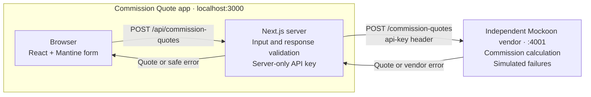

# Commission Quote
Generate commission quotes from loan details.

## Architecture



Architecture decisions:

- [ADR-001: React application starter](docs/architecture-decisions/ADR-001-React%20Application%20Starter%20Selection.md)
- [ADR-002: Mock vendor API](docs/architecture-decisions/ADR-002-Mock%20Vendor%20API%20Selection.md)

## Tech stack

- **Application:** Next.js App Router, React and TypeScript.
- **UI and validation:** Mantine components and forms, Zod schemas.
- **Mock vendor:** Mockoon CLI, running independently of the app.
- **Testing:** Jest, React Testing Library and AI-assisted Playwright browser tests.

## Run locally

Use Node.js 26.13.1.

1. Run `npm ci`.
2. Copy [.env.example](.env.example) to `.env.local` in the project root. Set
   `COMMISSION_VENDOR_API_KEY` to match the `api-key` response rule in
   [the mock definition](mocks/commission-vendor.json). Leave the default vendor URL.
3. Run `npm run dev` to start the app (port 3000) and mock vendor (port 4001),
   then open http://localhost:3000. Press Ctrl+C to stop both.

To run them separately, use `npm run dev:app` and `npm run mock:vendor`.

To run the production build locally, run `npm run build`, then `npm start`.
Keep the vendor running in its own terminal.

For a new Git worktree, run `.\setup-worktree.ps1` (Windows) or
`bash setup-worktree.sh` (Bash) from its directory.

## Verify

```sh
npm test
npm run build
npm run audit
```

`npm test` checks formatting, lint, types and automated tests.


## AI browser test

The application uses [@vickism/ai-ui-tests](https://www.npmjs.com/package/@vickism/ai-ui-tests) use test the application in a real browser with AI assistance.

Install Chromium once with
`npx --no-install playwright install chromium`.

Start the app with:

```powershell
npm run dev
```

Once ready, run the test in another terminal using a model that supports images and tool calls:

```powershell
$env:OPENAI_API_KEY = '<your-api-key>'
$env:AI_UI_TEST_MODEL = '<your-model-id>'
```
or configure the model and key in `ai-ui-tests.config.ts`.

Run the test:

```powershell
npm run test:ui
```
or to see the AI's thinking run

```powershell
npm run test:ui:verbose
```

Runs send app context and screenshots to model providers and incur API usage; use synthetic data only.

## Behavior and limitations

- The mock intentionally returns occasional 503 errors randomly. Its calculation rules are
  illustrative.
- There are no automatic retries.
- Quotes are not stored.

## Before production

- Add staff authentication and authorization; the application endpoint is currently public.
- Confirm the real vendor contract, currency, precision and lending limits; use managed credentials and HTTPS.
- Agree on idempotency, quote history, audit and retention requirements.
- Configure rate limits, runtime deadlines, monitoring and restricted operational logs.

## AI usage

AI assisted planning, implementation, tests, documentation and project tooling.
Changes were reviewed and verified with automated checks and browser testing.
Vendor Skills were used to generate code, review plans and provide guidance. [Next.js](https://nextjs.org/docs/app/guides/ai-agents), [Mantine](https://mantine.dev/guides/llms/#skills)